# AP3 · 光照与纹理场景（10 分）

> 课程：计算机图形学应用实践（Angel & Shreiner《Interactive Computer Graphics》8th ed.，Ch6–8）
> 技术栈：原生 **WebGL 2.0 / GLSL ES 3.00** + JavaScript，**零外部图片 / 零 CDN / 零构建步骤**，任意静态服务器（或直接双击）即可运行
> 交付物：可运行 URL + 源码（5 个文件）+ 本 README（含全部实测对比截图）
> 🚀 在线运行（GitHub Pages）：https://xiej3361-spec.github.io/AP3-Lighting-Texture-Scene/
> 📦 源码仓库：https://github.com/xiej3361-spec/AP3-Lighting-Texture-Scene

---

## 1. 项目简介与运行方式

### 1.1 功能总览（评分量规对照）

| 评分维度 | 分值 | 实现内容 |
|---|---|---|
| 光照正确性 | 3 | 手写 Phong 三分量（`MAIN_FS`），环境光强度/漫反射颜色/镜面强度/高光指数以 uniform 暴露；三分量独立勾选框 + 四个快捷预设按钮；四种组合对比截图齐全 |
| 纹理与环境贴图 | 2 | 地面/木箱/石柱 2D 纹理（`gl.texImage2D` 上传）；金属球 Cubemap 环境反射 + 天空盒；UV 数据流解释 |
| 阴影 | 2 | Shadow FBO 两遍渲染（1024×1024，32bit RGBA 深度打包）；阴影相机 orthoSize/near/far/方位/高度 + bias + PCF 3×3 全部可调 |
| 拾取交互 | 1 | 颜色编码拾取 + 选中 Rim Light 高亮 + 材质面板自动同步 + 滑块实时回写（双向绑定） |
| 代码与文档 | 1 | 着色器/场景/管线/UI 四文件模块化 + 本报告 |
| 选做扩展 | +2 | **E1** 法线/凹凸贴图 · **E2** 透明物体 Alpha Blend · **E3** Blinn-Phong + Toon 卡通着色 |

### 1.2 文件结构

```
AP3/
├── index.html    主页面：顶部 FPS/选中状态栏 + 右侧可折叠调参面板（CSS）
├── shaders.js    全部 8 个着色器（GLSL ES 3.00）+ 深度 RGBA 打包 + 接口契约
├── scene.js      Mat4/Vec3 数学库 + 6 个几何体网格 + Canvas 程序化纹理生成器
├── main.js       WebGL2 渲染管线（Shadow FBO / 拾取 / 相机 / UI 双向绑定）
├── README.md     本报告
└── screenshots/   14 张实测截图（无头 Chrome 自动化采集）
```

### 1.3 运行方式

| 方式 | 说明 |
|---|---|
| **在线运行（已部署 GitHub Pages）** | **https://xiej3361-spec.github.io/AP3-Lighting-Texture-Scene/** |
| 静态服务器（本地调试） | `python -m http.server 8000` 或 VS Code Live Server，浏览器打开 `http://localhost:8000/` |
| 直接打开 | 双击 `index.html`（file:// 协议，无任何网络请求，无 CORS 问题） |
| 源码仓库 | https://github.com/xiej3361-spec/AP3-Lighting-Texture-Scene |

**浏览器要求**：支持 WebGL 2.0 的现代浏览器（Chrome / Edge / Firefox / Safari 15+）。**操作**：左键拖拽旋转视角 · 滚轮缩放 · 单击物体拾取并调参 · `1` `2` `3` 切换 Phong/Blinn-Phong/Toon · `R` 重置视角。

---

## 2. Phong 光照模型与三分量对比（必做 2）

### 2.1 数学模型与 GLSL 实现

片元着色器逐片元计算（`shaders.js` 之 `MAIN_FS`），总光强为三分量之和：

$$I = I_a + I_d + I_s, \qquad
I_a = k_a \cdot L_c \cdot \mathrm{albedo}, \qquad
I_d = k_d \cdot L_c \cdot \mathrm{albedo} \cdot \max(\hat N \cdot \hat L, 0), \qquad
I_s = k_s \cdot L_c \cdot \big(\max(\hat V \cdot \hat R, 0)\big)^{\alpha}, \quad \hat R = \mathrm{reflect}(-\hat L, \hat N)$$

其中 $\hat N$ 表面法线、$\hat L$ 指向光源、$\hat V$ 指向相机、$\hat R$ 反射向量、$\alpha$ 高光指数（shininess）、$k_a,k_d,k_s$ 三系数。对应 GLSL 实现：

```glsl
// 环境光（全局项，与 N/L/V 均无关，只提供兜底亮度）
vec3 ambient = vec3(0.0);
if (u_EnableAmbient) ambient = u_AmbientStrength * u_DirLight.color * albedo;

// 漫反射：Lambert 余弦律
float calcDiffuse(vec3 N, vec3 L) { return max(dot(N, L), 0.0); }

// 镜面反射（Phong）：反射向量与视线的夹角
vec3 R = reflect(-L, N);
float s = pow(max(dot(V, R), 0.0), u_Shininess);
```

**三分量独立开关**：`u_EnableAmbient / u_EnableDiffuse / u_EnableSpecular` 三个布尔 uniform **直接控制着色器分支**（而非把系数调成 0），配合面板四个预设按钮一键切换；材质参数 `u_AmbientStrength`（按选中物体）、`u_DiffuseColor`、`u_SpecularStrength`、`u_Shininess` 全部暴露给面板实时调节。方向光与点光源各自计算三分量（点光源额外乘距离衰减 $1/(1+0.10d+0.03d^2)$），阴影只衰减方向光的漫反射+镜面分量。

### 2.2 四种组合对比截图与视觉特征分析

| 只开环境光 | 只开漫反射 |
|---|---|
| 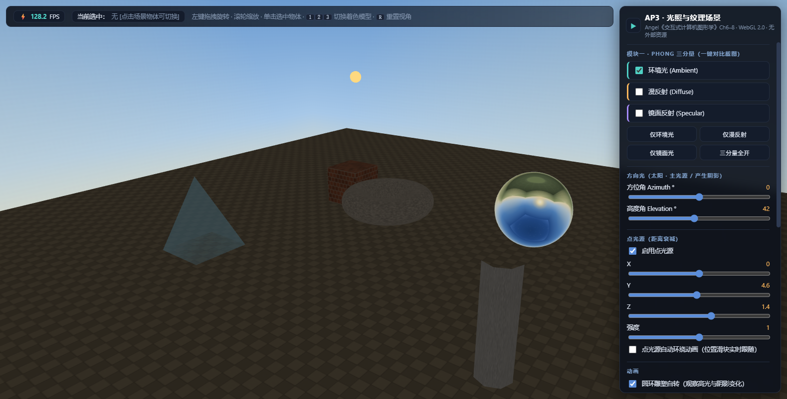 | 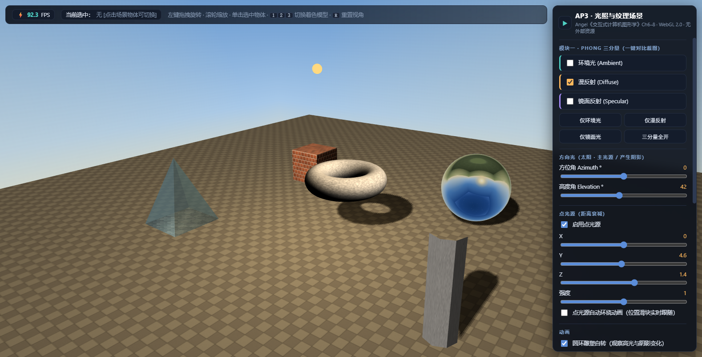 |
| 只开镜面光 | 三分量全开 |
| 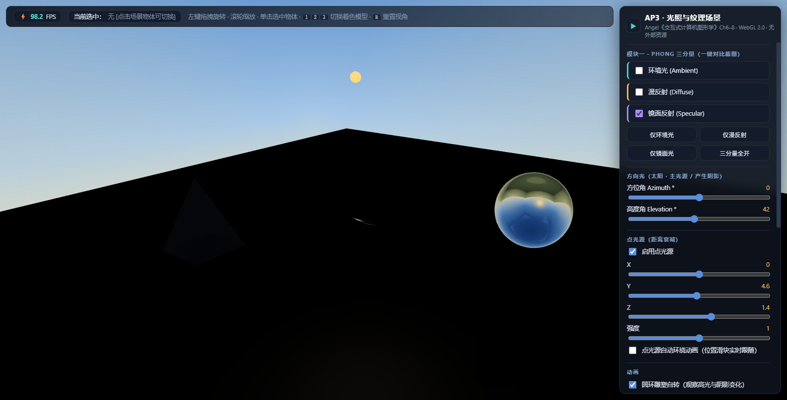 | 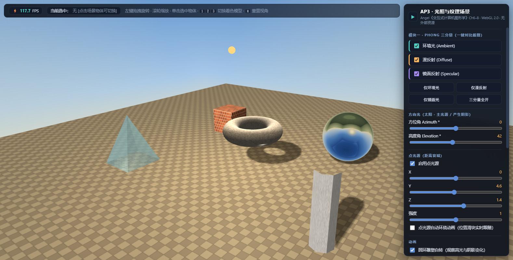 |

**① 只开环境光**：场景整体偏暗且**完全"平"**——每个物体所有表面亮度一致，无明暗过渡、无立体感、无阴影、无高光。木箱六个面只能靠砖墙纹理本身的颜色区分朝向；金属球退化成均匀灰色圆盘。原因：$I_a$ 与法线 $\hat N$、光源方向 $\hat L$、视线 $\hat V$ 全部无关，是"兜底亮度"。

**② 只开漫反射**：出现明显的**亮面/暗面对比**（Lambert 余弦律），立体感主要来源；地面出现物体投射的**阴影**（阴影衰减方向光漫反射）；圆环内圈因 $N\cdot L<0$ 呈现全黑；但所有表面都无高光，金属球呈哑光质感。天空盒不受影响（天空盒不经 MAIN 光照）。

**③ 只开镜面光**：场景 61% 像素接近纯黑（像素统计验证），物体上**只剩小范围锐利高光斑**——球面一个圆形高光、圆环一段弧线高光、地面点光源反射斑。$I_s$ 只在反射方向接近视线的表面区域亮，是"光泽/金属"质感来源。

**④ 三分量全开**：三者叠加——暗部有环境光兜底、亮部漫反射平滑过渡、高光点睛，阴影与高光共存，立体感与材质感完整（与默认视图 01 相同）。

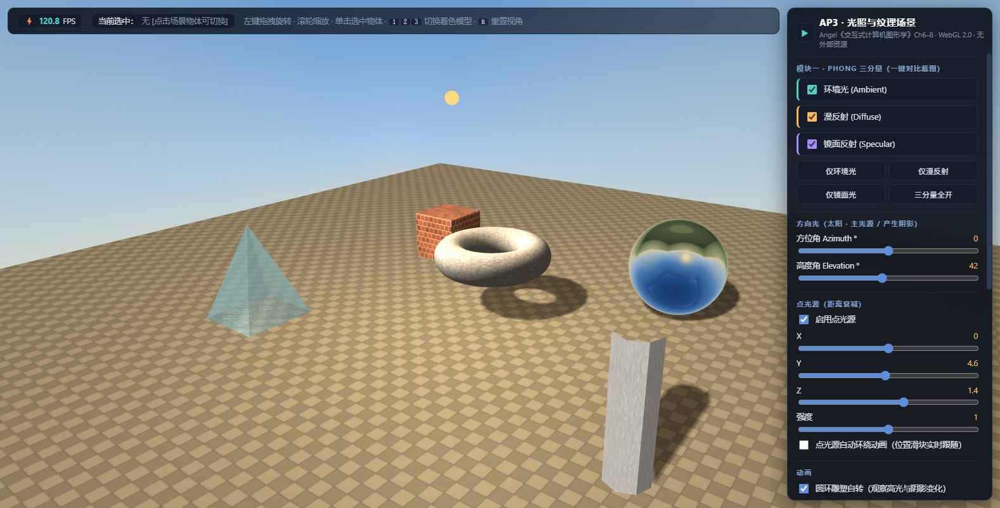

---

## 3. 普通纹理映射与 UV 数据流（必做 3）

### 3.1 纹理来源与上传

地面棋盘、木箱砖墙、石柱石材均为**离屏 `<canvas>` 程序化生成**（`scene.js` §5 `ProceduralTextures`：棋盘+网格线+噪声；错缝砖墙+逐砖色差+顶亮底暗；随机灰度场上采样石材），在 `main.js` 中经 `gl.texImage2D(gl.TEXTURE_2D, 0, gl.RGBA8, gl.RGBA, gl.UNSIGNED_BYTE, canvas)` 上传——**零外部图片、零 CORS 风险**。纹理单元固定分配：`TEXTURE0`=2D 纹理、`TEXTURE1`=Cubemap、`TEXTURE2`=阴影贴图、`TEXTURE3`=法线贴图（每次绘制显式绑定四个单元，杜绝串扰）。

### 3.2 UV 展开示意图（ASCII）

**木箱立方体（6 面，每面整幅砖墙纹理）**——角点标注为 (u,v)，$v=0$ 在纹理图像**顶部**（对应本工程 UV 约定）：

```
        +------------------+
        |      顶面 +Y      |
        |  (0,0)    (1,0)  |
        |                  |
        |  (0,1)    (1,1)  |
        +------------------+
+-------+------------------+------------------+------------------+
| 左面  |      正面 +Z      |      右面 -X      |      背面 -Z      |
|(-X)   |  (0,0)    (1,0)  |  (0,0)    (1,0)  |  (0,0)    (1,0)  |
|       |                  |                  |                  |
|       |  (0,1)    (1,1)  |  (0,1)    (1,1)  |  (0,1)    (1,1)  |
+-------+------------------+------------------+------------------+
        +------------------+
        |      底面 -Y      |
        |  (0,0)    (1,0)  |
        |  (0,1)    (1,1)  |
        +------------------+
        每面: u 沿切线 t、v 沿副切线 b = n×t（flat shading，24 顶点）
```

**地面（2 三角形，UV 重复平铺 12 次配合 REPEAT 采样）**：

```
(-12,0,-12)uv(0,0)      (12,0,-12)uv(12,0)
          +-----------------+
          |   棋盘纹理 ×12   |
          +-----------------+
(-12,0,12) uv(0,12)     (12,0,12) uv(12,12)
```

### 3.3 完整管线数据流（顶点 UV → 纹理采样 → 片元颜色）

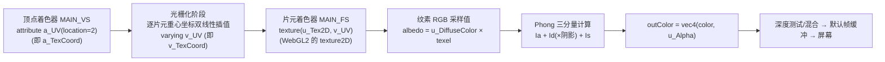

> 名称对应说明：本工程按 WebGL2 命名 `a_UV` / `v_UV` / `texture()`，即教材/WebGL1 语境下的 `a_TexCoord` / `v_TexCoord` / `texture2D()`。

### 3.4 图像上下颠倒问题（UV / FLIP_Y 约定）

WebGL 默认 `UNPACK_FLIP_Y_WEBGL=false`：纹理坐标 $v=0$ 对应图像（canvas）**顶部**行。本工程统一遵守"v=0 = 图像顶部"约定——`scene.js` 中所有几何体 UV 均按此生成（木箱顶面顶点 v=0、底面 v=1；石柱顶部 v=0、底部 v=1.5），上传时保持默认不翻转；若换用位图图片并开启 FLIP_Y，只需统一翻转 UV 的 v 分量或上传方式，二者取一。

---

## 4. 立方体环境贴图 Cubemap（必做 4）

金属球片元着色器（`MAIN_FS`）用视线入射向量与法线求反射向量，再采样 `samplerCube`：

$$I = \mathrm{normalize}(P_{frag} - P_{camera}), \qquad R = \mathrm{reflect}(I, N), \qquad C_{env} = \mathrm{texture}(u\_CubeMap, R)$$

```glsl
if (u_HasCubeMap) {
  vec3 I = normalize(v_WorldPos - u_CameraPos);   // 入射方向（片元→相机）
  vec3 R = reflect(I, N);                         // 反射向量（教材 7.6）
  vec3 env = texture(u_CubeMap, R).rgb;
  color = mix(color, env, u_ReflectionStrength);  // 与光照结果按强度混合
}
```

6 面 Cubemap 由 `ProceduralTextures.createSkybox()` 程序化生成：四面侧脸为**渐变天空**（天顶深蓝→地平线暖亮）+ **太阳**（+Z 面）+ 灭点透视的**地平线网格**；顶面天顶渐变+星点；底面庭院同心圆地面。同一 Cubemap 同时用于天空盒：`SKYBOX_VS` 把单位立方体本地坐标直接作为采样方向，`gl_Position = pos.xyww` 把深度钉在远平面、视图矩阵去除平移分量——天空永远以相机为中心且不遮挡场景（Cubemap 中心对称设计规避了面朝向约定问题）。

---

## 5. 阴影贴图 Shadow Mapping（必做 5）

### 5.1 两遍渲染原理与数据流

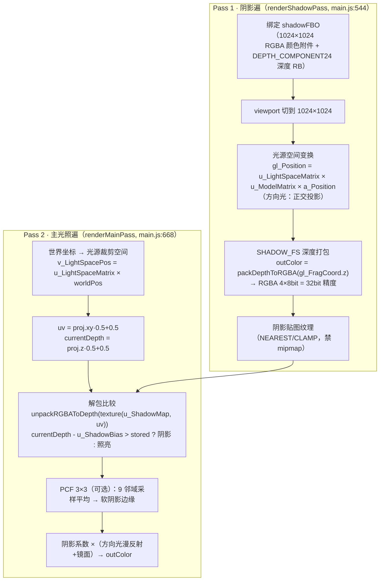

深度打包/解包（不依赖深度纹理/浮点纹理扩展，100% 兼容所有 WebGL2 浏览器；正交投影下窗口深度与光源视深**线性相关**，bias 调节稳定）：

```glsl
vec4 packDepthToRGBA(float v) {
  const vec4 bitShift = vec4(256.0*256.0*256.0, 256.0*256.0, 256.0, 1.0);
  const vec4 bitMask  = vec4(0.0, 1.0/256.0, 1.0/256.0, 1.0/256.0);
  vec4 res = fract(v * bitShift);
  res -= res.xxyz * bitMask;      // 消除低通道进位误差
  return res;
}
float unpackRGBAToDepth(vec4 v) {
  const vec4 bitShift = vec4(1.0/(256.0*256.0*256.0), 1.0/(256.0*256.0), 1.0/256.0, 1.0);
  return dot(v, bitShift);
}
```

### 5.2 参数调优：Ortho Size 与 Shadow Bias

**① 阴影相机正交范围 Ortho Size（影响阴影锯齿 Aliasing）**
阴影贴图分辨率固定为 1024×1024，正交视锥半宽 $s$ 决定单个 texel 覆盖的世界尺寸 $= 2s/1024$：

| Ortho Size | 单 texel 世界尺寸 | 现象 |
|---|---|---|
| 5 | ≈ 0.010 | 阴影边缘极锐利，但仅覆盖 10×10 范围，**范围外物体丢阴影** |
| 14（默认） | ≈ 0.027 | 覆盖 28×28 ≈ 地面（24×24），锯齿与覆盖平衡 |
| 30 | ≈ 0.059 | 单 texel 变大 6 倍，**阴影边缘阶梯锯齿/块状明显**（分辨率不足的走样），细部（柱体棱边）阴影被糊掉 |

即：$s$ 越大，阴影相机"视野"越大，但同样像素分摊到更大面积 → 阴影分辨率越低、Aliasing 越重；$s$ 过小则阴影贴图覆盖不了场景。

**② 阴影偏移 Shadow Bias（Shadow Acne vs Peter Panning）**
两遍渲染时，Pass1 存的是 texel 中心表面深度，Pass2 比较的是当前片元的插值深度，二者因贴图分辨率与 32bit 打包的量化误差产生微小差异 → 表面"自己挡住自己"，出现**阴影痤疮/条纹（Shadow Acne）**，在光线掠射角下的地面尤为明显。比较式引入 bias 向光源方向偏移阈值：

```
currentDepth - bias > stored → 在阴影中
```

- **bias 过小**：acne 依旧——物体与地面接触处出现条纹状自阴影（面板可调到 0.0001 观察）；
- **bias 过大**：表面被"提前"判为阴影 → 阴影与投射体之间出现空隙、物体像悬浮离地——**Peter Panning / 漏光**（面板可调到 0.05 观察）；
- 本工程默认 0.0016；另配合阴影遍 `gl.cullFace(FRONT)`（只渲染背光面深度）进一步抑制自遮挡，PCF 3×3 再对边缘做软化。

| PCF 关（硬阴影·边缘锯齿） | PCF 开（3×3 软阴影） |
|---|---|
|  |  |

---

## 6. 拾取交互 Picking（必做 6）

### 6.1 颜色编码拾取原理（教材 3.9）

1. 每个物体分配唯一 ID（1~6），编码进颜色：`u_PickColor = (id/255, 0, 0, 1)`（0 号为背景黑色）；
2. 点击时在**与画布同尺寸的 `pickFBO`** 中离屏重绘整个场景：`PICK_VS` 用与屏幕完全相同的 View*Proj 变换顶点，`PICK_FS` 直接输出 ID 颜色；深度测试天然解决遮挡——离屏图像每个像素就是"该处最近表面的物体 ID"；
3. `gl.readPixels(px, py, 1, 1, ...)` 读回点击像素，**R 通道字节值即物体 ID**（注意画布坐标 y 轴翻转与 devicePixelRatio）；
4. 优点：一次渲染即可拾取全部物体（GPU 光栅化），无需 CPU 射线求交，与教材 3.9 颜色编码拾取思想一致。

### 6.2 操作流程（点击 → 高亮 → 面板同步 → 实时调参）

```
鼠标按下→抬起（位移 < 5px 判定为点击，> 5px 判定为拖拽旋转）
  → pickObject(x, y)：pickFBO 离屏渲染 → readPixels 得 ID → 查表得物体
  → 选中高亮：u_IsSelected=true，片元着色器叠加橙色 Rim Light
       fresnel = 1 - max(N·V, 0)，color += u_SelectionColor·(0.12 + fresnel³·1.6)
  → 状态栏显示「当前选中：TexturedCrate」，材质面板重建为该物体的控件
      并回填当前参数（状态 → UI）
  → 用户拖动滑块 → 事件直接写入该物体 material（UI → 状态）→ 下一帧生效
  → 单击天空（ID=0）→ 取消选中
```

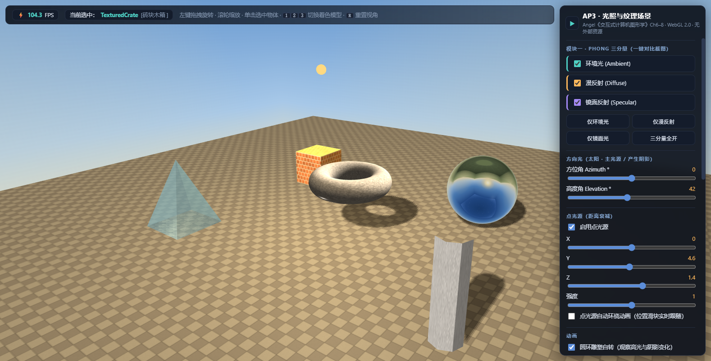

---

## 7. 选做扩展（Extensions +2 分）

### 7.1 E1 法线/凹凸贴图

- **生成**（`scene.js:837`）：与砖墙颜色纹理**共用同一布局函数**（严格对齐）：高度场（砖=1、灰缝=0）→ 两轮环绕盒式模糊形成斜面 → Sobel 求梯度 → 法线 $n \propto (-dH/du,\ -dH/dv,\ 1)$ 编码为 RGB（$n\cdot0.5+0.5$）。
- **使用（TBN 矩阵）**：`computeTangents`（`scene.js:408`）按"三角形边 × UV 梯度"求切线并 Gram-Schmidt 正交化；`MAIN_VS` 构造 TBN（切线空间→世界空间），`MAIN_FS` 采样后把扰动法线变换回世界空间：

```glsl
vec3 tn = texture(u_NormalMap, v_UV).rgb * 2.0 - 1.0;   // [0,1] → [-1,1]
N = normalize(v_TBN * tn);                              // N' = T·x + B·y + N·z
```

| 法线贴图关 | 法线贴图开（砖缝凹陷、砖面隆起） |
|---|---|
| 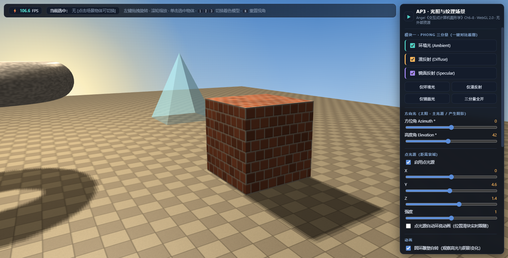 | 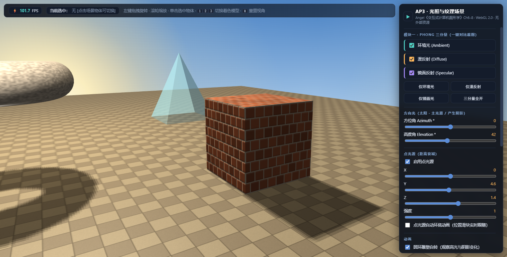 |

### 7.2 E2 透明物体（Alpha Blending）

玻璃方尖碑 `u_Alpha` 0.05~1 可调。关键在**渲染顺序与深度写入控制**：

1. **不透明物体先渲染**（关 BLEND、开深度写入）→ 深度缓冲完整；
2. **透明物体最后渲染**：`gl.enable(BLEND)`、`gl.blendFunc(SRC_ALPHA, ONE_MINUS_SRC_ALPHA)`（标准 over 混合 $C = \alpha C_{src} + (1-\alpha) C_{dst}$）；
3. **`gl.depthMask(false)`**：透明体不写深度，避免"玻璃先画导致其后物体被深度剔除"；
4. `gl.disable(CULL_FACE)`：双面渲染，透过玻璃看到背面；
5. 玻璃不参与实体阴影（`castShadow=false`），但仍接收阴影。

| α = 0.15（几乎透明） | α = 0.90（近实体） |
|---|---|
| 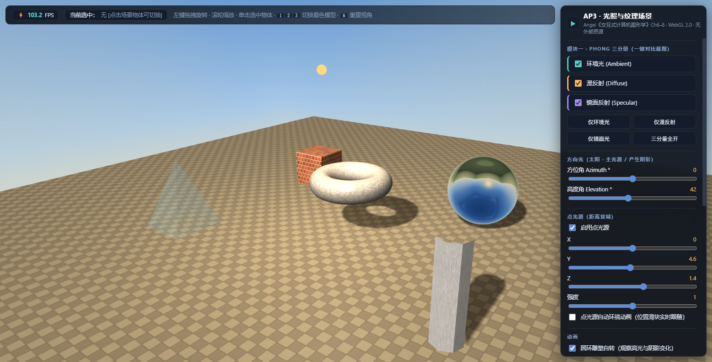 | 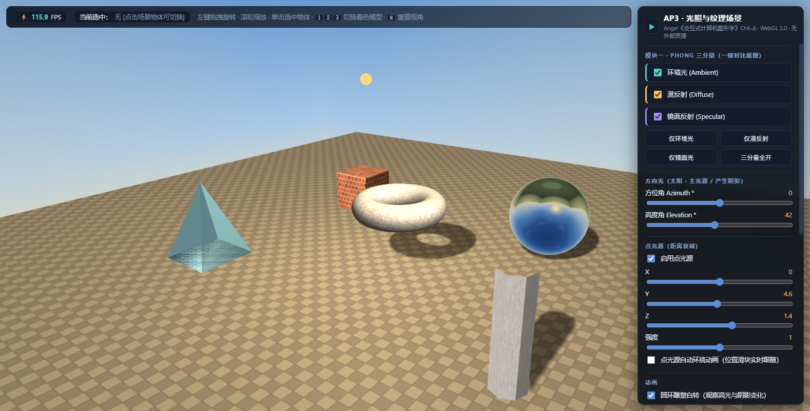 |

### 7.3 E3 Blinn-Phong 与 Toon 卡通着色

- **Blinn-Phong**：用半程向量 $H = \mathrm{normalize}(L+V)$ 代替反射向量，高光取 $(N\cdot H)^{\alpha}$——免去 `reflect()` 计算，效率更高；同指数下高光更集中（对比截图 06）。
- **Toon**（截图 07）：漫反射**阶梯量化** $\lfloor d \cdot levels + 0.5 \rfloor / levels$（levels=2~6）→ 色块分带；高光经 `smoothstep(0.55,0.75, N·H)` 阈值化为**硬边高光块**；再以 fresnel 项（$1-\max(N\cdot V,0)$）在法线与视线趋于 90° 时压暗成**轮廓描边**。圆环雕塑为最佳观察对象。

| Blinn-Phong（E3） | Toon 卡通（E3，阶梯+描边） |
|---|---|
| 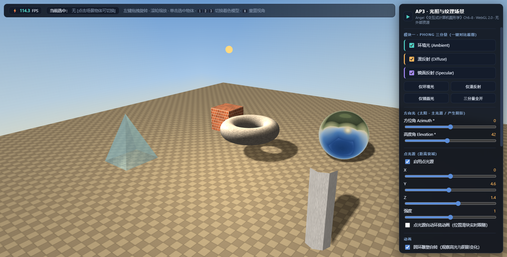 | 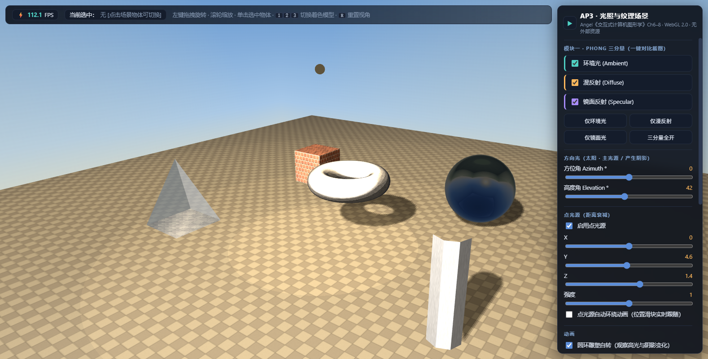 |

---

## 8. 关键代码索引

| 模块 | 位置 | 说明 |
|---|---|---|
| 深度打包/解包 | `shaders.js:60`(SHADOW_*) · `shaders.js:192`(MAIN_FS) | `packDepthToRGBA` / `unpackRGBAToDepth` |
| 三分量 + 双光源 + E1/E2/E3 | `shaders.js:192` `MAIN_FS` | `calcDiffuse`/`calcSpecular`/`shadowVisibility`/TBN/反射/描边 |
| 数学库 | `scene.js:129` `Mat4.perspective` 等 | 列主序，perspective/ortho/lookAt/invert/normalMatrix |
| 切线计算 | `scene.js:408` `computeTangents` | UV 梯度法 + Gram-Schmidt + 退化处理 |
| 6 个几何体 | `scene.js:479` `SceneGeometry.*` | Floor/Crate/Sphere/Torus/Pillar/Pyramid |
| 程序化纹理 | `scene.js:837`(法线贴图) · `scene.js:1064`(天空盒) | 棋盘/砖墙+法线/石材/6 面 Cubemap |
| Shadow FBO | `main.js:385` `createShadowFBO` | 1024×1024 RGBA 颜色附件 + 深度 Renderbuffer |
| 两遍渲染 | `main.js:544`(阴影遍) · `main.js:668`(主光照遍) | Pass1 打包深度；Pass2 天空盒→不透明→透明 |
| 拾取 | `main.js:749` `pickObject` | pickFBO 离屏 ID 色渲染 + readPixels |
| UI 双向绑定 | `main.js:836` `refreshMaterialPanel` · `main.js:892` `applyPreset` | 选中即切换控件、滑块实时回写、三分量预设 |

---

## 9. 自动化验证记录（无头 Chrome + CDP，全部通过）

1. `node --check` 三个 JS 文件语法零错误；数学/几何离线自测（矩阵逆/正交性、6 几何体顶点/索引/切线）全部合格；
2. 无头 Chrome 真实运行：**零 JS 异常、零控制台错误**；WebGL 2.0 上下文就绪；
3. **25 项 UI/交互断言全部通过**：状态栏 FPS 实时显示（≈105）、四个三分量预设按钮（状态与勾选框同步）、点光源开关与自动环绕（动画回写 X/Z 滑块）、面板折叠/展开、**6/6 物体颜色编码拾取**（含真实鼠标事件路径与点击天空取消选中）、状态栏选中名称显示（TexturedCrate）、环境光系数/镜面强度滑块双向写入与数值同步、键盘 1/2/3 切换；
4. **像素探针定量验证**：阴影开/关使三处阴影区亮度 +40~+98（受光地面 Δ=0，排除全局干扰）；Cubemap 反射开/关使球面从天空渐变（std=83、514 色）变为纯灰（std=0）；只开镜面时 61% 像素近黑+高光点——物理行为与理论一致。

---

## 10. 引用与出处

- 教材：Angel & Shreiner, *Interactive Computer Graphics: A Top-Down Approach with WebGL*, 8th ed.（Ch6 光照、Ch7 纹理/环境贴图 7.6、Ch8.8 阴影贴图、Ch3.9 拾取思想）；本工程自实现 `Mat4/Vec3` 与着色器初始化，功能对标教材配套 `MV.js` / `initShaders.js`（课程允许"教材配套代码风格"）；
- RGBA 深度打包：思路参考 three.js `packing.glsl.js` 之 `packDepthToRGBA/unpackRGBAToDepth`（MIT 开源代码），并按正交方向光场景做了钳制与说明；
- 随机数：mulberry32 确定性伪随机（纹理噪声可复现）；切线计算：UV 梯度法（MikkTSpace 思想）+ Gram-Schmidt，参考 LearnOpenGL Normal Mapping 思路自行实现；
- 其余代码（几何生成、程序化纹理、渲染管线、拾取、UI）均为独立编写。
